<p align="center">
  
</p>

# 🚀 Awesome API Account & License Management

> 🌟 A curated list of SaaS platforms and open-source software for API account management, license key enforcement, entitlement management, API metering, and usage-based monetization.

<p align="left">
  <a href="https://github.com/ishandutta2007/Awesome-Awesome-Awesome"></a>
  <a href="https://discord.gg/jc4xtF58Ve"></a>
  <a href="https://github.com/ishandutta2007/Awesome-API-Account-License-Management/pulls"></a>
  <a href="http://creativecommons.org/publicdomain/zero/1.0/"></a>
  <a href="https://github.com/ishandutta2007/Awesome-API-Account-License-Management/stargazers"></a>
  <a href="https://github.com/ishandutta2007"></a>
</p>

**API Account & License Management** encompasses tools, gateways, and frameworks that empower companies to authenticate API consumers, issue cryptographically signed license keys, enforce usage quotas and seats, meter AI token/API consumption, and monetize API products.

---

## 📑 Table of Contents

- [📊 Sector Overview & Market Dynamics](#-sector-overview--market-dynamics)
- [☁️ SaaS / Hosted Platforms](#️-saas--hosted-platforms)
- [💻 Open-Source GitHub Projects](#-open-source-github-projects)
- [🧩 Feature Matrix: Gateway vs. Entitlement vs. Metering](#-feature-matrix-gateway-vs-entitlement-vs-metering)
- [📈 Star History](#-star-history)
- [💖 Support & Community](#-support--community)
- [🤝 How to Contribute](#-how-to-contribute)
- [⚠️ Disclaimer](#️-disclaimer)

---

## 📊 Sector Overview & Market Dynamics

The global API Management market is estimated at **$6.89B–$8.86B in 2025** and projected to exceed **$8.77B–$10.32B in 2026**, expanding rapidly at a CAGR of ~20% toward $37B+ by 2034 driven by pervasive microservices adoption, multi-cloud migrations, and surging LLM/AI token metering demands. 

The sector displays a **moderately fragmented and layered structure**: while hyper-scalers (Google Cloud Apigee, AWS, Salesforce MuleSoft) dominate enterprise legacy digital transformation, agile pure-play connectivity and specialized platforms (Kong, Postman) command high-velocity developer workflows, leaving substantial white-space for emerging, composable open-source entitlement engines, specialized licensing platforms, and usage-based metering layers.

---

## ☁️ SaaS / Hosted Platforms

Below is a comparison of commercial SaaS and managed cloud solutions for API management, developer accounts, licensing, and monetization, sorted in descending order by company valuation / market capitalization.

| 🏢 Product | 💰 Valuation / Revenue Scale | 🎯 Primary Focus | 💳 Starting Price | 🎁 Free Tier / Trial Limits |
|:---|:---|:---|:---|:---|
| **[Google Cloud Apigee](https://cloud.google.com/apigee)** | Alphabet Market Cap: **~$2.1T+** | Enterprise Full-Lifecycle API Management, Analytics & Monetization | Pay-As-You-Go: **$0.50–$0.70/hr** per active environment + **$20/million** standard API calls (**$100/million** extensible calls) | **60-day Free Evaluation Trial** with full enterprise capabilities |
| **[AWS Marketplace Management](https://aws.amazon.com/marketplace)** | Amazon Market Cap: **~$2.0T+** | API Product Catalog, Procurement & Monetization via AWS Entitlement APIs | **No upfront fees**; AWS revenue-share take rate of **3%** of TCV for SaaS listings (scales down to 1.5%–2% for large contracts) | **Free to list**; supports vendor-configured 15, 30, or 60-day free buyer trials |
| **[MuleSoft Anypoint Platform](https://www.mulesoft.com)** | Salesforce Market Cap: **~$280B+** (Acquired for $6.5B) | Enterprise Integration, API Gateway & API-led Connectivity | Custom annual enterprise contracts starting at approx. **$2,000/month** ($24,000/year base) | **30-day Free Trial**; evaluation only, non-production sandbox |
| **[Software AG webMethods](https://www.ibm.com/products/webmethods)** | IBM Market Cap: **~$210B+** (Acquired for €2.13B) | Hybrid Integration, B2B Gateway, API Management & Governance | Quote-based enterprise subscription; typical modular cloud tiers start at **~$1,500/month** | **30-day Free Trial** (capped at 100,000 API calls & 1,000 transactions/day); Free Forever developer community tier capped at 10,000 calls/mo |
| **[Postman](https://www.postman.com)** | Valuation: **$5.6B** (Peak Series D; ~$313M Revenue) | API Development, Mocking, Testing & Consumer Account Collaboration | **$9/user/month** (Solo, billed annually) or **$19/user/month** (Team, billed annually) | **Free Forever plan** limited strictly to **1 user**, 5 integrations, and 10,000 Postman API calls/month |
| **[Kong Konnect](https://konghq.com/products/kong-konnect)** | Valuation: **$2.0B** ($100M+ ARR) | Cloud-Native API Gateway, Service Mesh & Native API/AI Metering & Billing | **$25/month** per Serverless Control Plane, or **$200/month** for Hybrid Control Plane + $200 per million calls (includes 1M calls/mo) | **30-day Free Trial** of Konnect Plus; or unlimited free self-hosted open-source core via Kong Gateway OSS |
| **[Axway Amplify](https://www.axway.com/en/products/api-management)** | Market Cap: **~€800M–€1.1B** (~$1.1B–$1.3B; €707M Group Revenue) | Universal API Management, Catalog & Enterprise Marketplace | Enterprise subscription starting at **~$18,000/year** ($1,500/month) for connected gateway/Amplify Engage tiers | **No public self-service free trial**; evaluation granted via gated Proof of Concept (PoC) and custom live demo |
| **[WSO2](https://wso2.com/api-management/)** | Valuation: **~$600M** (~$100M+ ARR; Acquired by EQT) | 100% Open-Source Full Lifecycle API Management & Enterprise Governance | Commercial enterprise support & WSO2 SaaS tiers start at **~$1,500/month** | **Free Forever (Apache 2.0)** on self-hosted infrastructure with zero license fees; 14-day trial of Cloud SaaS |
| **[Tyk Technologies](https://tyk.io)** | Valuation: **~$140M** (£11.6M+ Revenue) | Open-Source API Gateway, Developer Portal & Management Dashboard | Quote-based; Core Plan starts at **~$600/month** for managed hybrid setups (or custom consumption tiers) | **48-hour Free Trial** for Tyk Cloud SaaS (full feature access, no credit card required); Free forever Tyk OSS Gateway |
| **[RapidAPI Enterprise Hub](https://rapidapi.com/enterprise)** | Valuation: **~$106M** (Series D Peak $1B; Acquired by Nokia) | Internal & External API Marketplace, Developer Portals & Federation | Custom enterprise quote; historical team tiers started at **~$99/month** | **Default Basic plan** provides free internal API consumption without license charges; 30-day enterprise evaluation demo |

---

## 💻 Open-Source GitHub Projects

Self-hosted and community-supported open-source solutions for API gateways, entitlement enforcement, license key issuance, and usage metering. Sorted in descending order by GitHub stargazers count.

| 📦 Project | ⭐ Stars | 📄 License | 🛠️ Tech Stack | 📌 Primary Focus & Capabilities |
|:---|:---|:---|:---|:---|
| **[Kong Gateway](https://github.com/Kong/kong)** | [](https://github.com/Kong/kong/stargazers) | Apache-2.0 | Lua, NGINX | Cloud-native, high-performance API gateway and microservice management layer supporting authentication, rate limiting, and observability plugins. |
| **[One-API](https://github.com/songquanpeng/one-api)** | [](https://github.com/songquanpeng/one-api/stargazers) | MIT | Go, React | Multi-LLM API management, key distribution, quota allocation, user balance tracking, and consumption billing across AI provider endpoints. |
| **[Apache APISIX](https://github.com/apache/apisix)** | [](https://github.com/apache/apisix/stargazers) | Apache-2.0 | Lua, NGINX | Dynamic, real-time, high-performance API gateway providing traffic routing, dynamic rate-limiting, authentication, and security observability. |
| **[Tyk Gateway](https://github.com/TykTechnologies/tyk)** | [](https://github.com/TykTechnologies/tyk/stargazers) | MPL-2.0 | Go | Lightweight, fast open-source HTTP/GraphQL/gRPC API gateway with rate limiting, quota enforcement, and detailed analytics collection. |
| **[Lago](https://github.com/getlago/lago)** | [](https://github.com/getlago/lago/stargazers) | AGPL-3.0 | Ruby, Go | Open-source metering and usage-based billing engine. Provides consumption tracking, customer wallet top-ups, tiered pricing iterations, and invoice generation. |
| **[OpenMeter](https://github.com/openmeterio/openmeter)** | [](https://github.com/openmeterio/openmeter/stargazers) | Apache-2.0 | Go, ClickHouse | High-throughput, real-time usage metering for AI, APIs, and cloud services. Collects millions of event meters per second to drive billing and entitlement enforcement. |
| **[API Umbrella](https://github.com/NatLabRockies/api-umbrella)** | [](https://github.com/NatLabRockies/api-umbrella/stargazers) | MIT | Ruby, Lua | Battle-tested API management platform used by US government agencies (api.data.gov) for unified API key authentication, rate limiting, and analytics. |
| **[Fusio](https://github.com/apioo/fusio)** | [](https://github.com/apioo/fusio/stargazers) | AGPL-3.0 | PHP | Open-source API management and development platform for building REST APIs with integrated user accounts, app subscriptions, quota monetization, and rate limits. |
| **[APIPark](https://github.com/APIParkLab/APIPark)** | [](https://github.com/APIParkLab/APIPark/stargazers) | Apache-2.0 | Go, React | Open-source AI & API gateway and developer developer portal. Manages multi-model AI LLM credentials, token rate-limiting, consumer approvals, and invocation statistics. |
| **[Keygen API Core](https://github.com/keygen-sh/keygen-api)** | [](https://github.com/keygen-sh/keygen-api/stargazers) | Fair Source (ELv2) | Ruby | Mature software licensing and entitlement API engine. Manages cryptographically signed license keys, offline verification, machine activations, and seat allocations. |
| **[WSO2 API Manager](https://github.com/wso2/product-apim)** | [](https://github.com/wso2/product-apim/stargazers) | Apache-2.0 | Java | Fully featured 100% open-source API management suite containing an API Publisher, Developer Store/Portal, Traffic Manager, Gateway, and Key Manager. |
| **[Gravitee API Management](https://github.com/gravitee-io/gravitee-api-management)** | [](https://github.com/gravitee-io/gravitee-api-management/stargazers) | Apache-2.0 | Java | Comprehensive, event-native API management platform offering API design, developer portals, policy orchestration, and OAuth2 security access control. |
| **[Keygate](https://github.com/tabloy/keygate)** | [](https://github.com/tabloy/keygate/stargazers) | MIT | Go | Purpose-built self-hosted license server providing perpetual/subscription licensing, floating seats, atomic quota enforcement, and Stripe checkout synchronization. |
| **[NetLicensing MCP](https://github.com/Labs64/NetLicensing-MCP)** | [](https://github.com/Labs64/NetLicensing-MCP/stargazers) | Apache-2.0 | Python | Model Context Protocol (MCP) server interface that equips autonomous AI agents with tools to query, assign, and audit software licenses and customer entitlements. |

---

## 🧩 Feature Matrix: Gateway vs. Entitlement vs. Metering

When architecting an API monetization or licensing infrastructure, choose components based on architectural responsibilities:

```
+-----------------------------------------------------------------------------------+
|                              Client / Consumer                                   |
+-----------------------------------------+-----------------------------------------+
                                          |
                      1. Present License Key / API Token
                                          v
+-----------------------------------------------------------------------------------+
| API GATEWAY / REVERSE PROXY LAYER (Kong OSS, Tyk, Apache APISIX)                  |
| - Authenticates incoming request header & signature                              |
| - Enforces active rate-limits & circuit breaking                                  |
+-----------------------------------------+-----------------------------------------+
                                          |
            2. Validate Entitlement       |      3. Emit Consumption Events
                      v                   |                   v
+-----------------------------------------+--+ +------------------------------------+
| LICENSE / ENTITLEMENT ENGINE               | | USAGE METERING & BILLING ENGINE    |
| (Keygate, Keygen Core, NetLicensing)       | | (Lago, OpenMeter, Stripe)          |
| - Verifies plan tier, seats & expiry date  | | - Ingests real-time raw events     |
| - Validates offline ed25519 signatures     | | - Aggregates token & request counts|
| - Manages device & machine activations     | | - Deducts prepaid wallet balance   |
+--------------------------------------------+ +------------------------------------+
```

- 🌐 **Full-Lifecycle API Management Suites (WSO2, Apigee, MuleSoft, Tyk, Gravitee):** Provide developer portals, API key generation, proxy routing, rate-limiting, and documentation out of the box.
- 🔑 **Dedicated License Enforcement Servers (Keygate, Keygen):** Specialized in license key cryptographic generation, machine fingerprinting, seats/floating licenses, and subscription state.
- ⚡ **Usage Metering & Monetization Engines (Lago, OpenMeter):** High-frequency event ingestion that connects API transactions and LLM token counts directly to invoicing and billing gateways.

---

## 📈 Star History

[](https://www.star-history.com/#ishandutta2007/Awesome-API-Account-License-Management&type=date&legend=top-left)

---

## 💖 Support & Community

Thank you so much for exploring and supporting **Awesome API Account & License Management**! If you find this curated collection helpful in designing or scaling your API infrastructure:

- 🌟 **Star the repository** to boost visibility and help other platform engineers discover it.
- 🍴 **Fork the repo** to contribute new tools, updates, and ecosystem developments.
- 📢 **Share it** with your network, team, or developer community on X, LinkedIn, or Discord!
- ☕ **Buy me a coffee / Sponsor**: If this project saved you research time or added value to your work, consider supporting continued maintenance via the [GitHub Sponsors Dashboard](https://github.com/sponsors/ishandutta2007). Every bit of support is deeply appreciated!

---

## 🤝 How to Contribute

We welcome community contributions, additional projects, and verified pricing corrections!

1. 🍴 **Fork the repository** on GitHub.
2. 📝 **Edit `README.md`** following the established table formats:
   - For SaaS products, provide exact starting tier pricing, free tier/trial limits, and company scale valuation/revenue.
   - For Open-Source projects, provide repository link, star badge (`style=social&color=white` linking to `/stargazers`), license, tech stack, and concise description.
3. 🚀 **Submit a Pull Request** with a brief summary of additions or updates.

---

## ⚠️ Disclaimer

- 📌 This repository is a community-curated informational resource; inclusion does not constitute an endorsement.
- 🏷️ All product names, trademarks, logos, and brands belong to their respective owners.
- 💡 SaaS pricing tiers, terms of service, and free trial constraints are subject to change by vendors; always check official vendor websites for current agreements.

---

<p align="center">
  <b>Built with ❤️ for platform engineers, product leaders, and developers building robust API licensing systems.</b><br>
  <sub>Found this helpful? Don't forget to star the repository! ⭐</sub>
</p>
